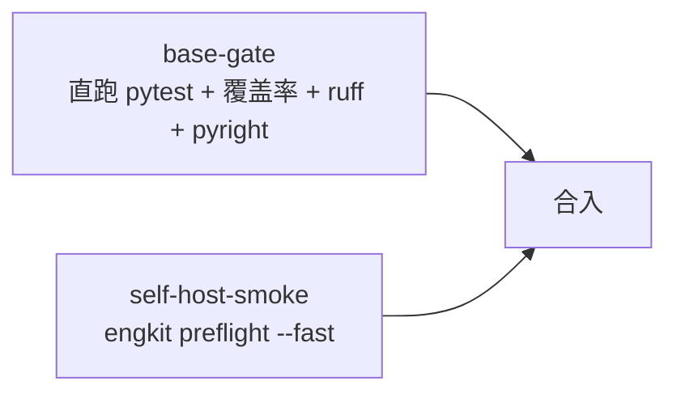

# 工程化工具包说明

> 定位、子命令、配置字段全表与门禁口径

[文档首页](../文档首页.md) › 概述　|　[接入说明 →](../资料/工具/接入说明/01_接入步骤.md)

## 1. 为什么抽成独立仓 <a id="why"></a>

护栏与开发脚本原先只在单个仓库内、且写死该仓的目录结构：文档校验只扫自己的文档根、预检的工程清单按本仓布局硬编码、用例登记只有文档模板没有脚本。各仓若各自复制一份，护栏会变成多份实现、口径必然分叉。

因此抽成**独立仓库与可安装包**：各仓以 git 源依赖或路径探测引用同一份实现，新增仓库只加配置、不改代码。

## 2. 四个设计约束 <a id="constraints"></a>

| # | 约束 | 落地方式 |
| --- | --- | --- |
| 1 | **包内无仓名字面** | 路径、工程分组、包名、步骤命令、规则数据一律来自仓配置；用例里由 `test_guards.py` 扫源码断言 |
| 2 | **单一来源** | 选测 / 并行档位 / 覆盖率门禁 / 重命令拦截各只有一份实现；各仓入口只做转发 |
| 3 | **核心零三方依赖** | 只依赖标准库（`tomllib` 解析配置）；增强能力缺装时显式降级。**唯一运行期依赖是 `pytest-xdist`**（并行档位 `-n` 的提供者，随本包安装，各接入仓无需自行声明；缺失时并行档位显式降级为串行） |
| 4 | **配置非法即失败** | 缺段 / 类型错 / 未知键一律报错退出码 2，不靠缺省值掩盖 |

## 3. 子命令 <a id="commands"></a>

| 子命令 | 作用 | 关键参数 | 退出码 |
| --- | --- | --- | --- |
| `links` | 文档相对链接与锚点校验 | `--root` `--config` `--quiet` | 0 通过 / 1 有问题 / 2 文档根缺失 |
| `docs-scope` | 进度类字段落点护栏 | `--self-test` | 0 零违规 / 1 有违规 / 2 文档根缺失 |
| `selection` | 变更 → 测试文件 / 覆盖率模块 / 前端包 | `--scope` `--changed-from` `--changed-file(-list)` `--format` `--force-full` `--depth` | 0 正常 / 1 推导异常 |
| `run-selected` | 选测 → 跑 pytest → 覆盖率门禁 → 扩圈 → 退化 | `--changed-from` `--jobs` `--cov-fail-under` `--max-rounds` `--timeout` `--depth` | pytest 码 / 1 异常 / 124 超时 |
| `run-changed` | **开发环**：改动文件 ruff → 附加步骤（`[[devloop.steps]]`）→ 后端直接依赖测试 → 前端受影响包（不带覆盖率） | `--changed-from` `--changed-file(-list)` `--jobs` `--timeout` `--no-lint` `--no-steps` `--no-frontend` | 0 全通过 / 非 0 首个失败环节 |
| `coverage` | 合并并行采集数据并判定 | `--data-file` `--out` `--module` `--fail-under` `--clean` | 0 达标 / 1 未达标 / 2 环境错误 |
| `preflight` | 预检引擎（**仅 CI 可手动调用**；本地由 `push` 触发） | `--fast`（无参即本档）/ `--full` / `--no-scope` / `--no-cov` / `--jobs` / `--budget-seconds` / `--step-seconds` / `--self-test` | 0 全通过 / 1 有失败或被拦截 / 2 本地手动调用或配置非法 |
| `push` | 推送入口：档位自动选择 + 预检 + 推送 | `--check` / `--full` / `--remote` / `--branch` / `--jobs` / `--budget-seconds` / `--step-seconds` | 0 通过 / 1 被拒绝或预检失败 / git push 的退出码 |
| `run_once` | 重命令缓存回放 | `--force` `--show` `--window-seconds` `--cache-dir` | 透传 / 2 选项错 |
| `guard` | 重命令拦截与 `.pth` 钩子管理 | `check` / `install-hook` / `check-hook` / `remove-hook` | 0 放行 / 1 拦截或钩子缺失 / 2 参数错 |
| `kiwi` | 用例批量登记与回读 | `register --cases`（`--dry-run`）/ `list --limit` / `ping` | 0 成功 / 1 远端失败 / 2 凭据或清单问题 |
| `base <名>` | 基座校验器组（规则数据来自 `[rules.<名>]`）：`base` / `backend-base` / `service-boundaries` / `bare-collections` / `system-fields` / `prototype-review` / `env-example` / `docs-status` / `boundary-metrics` / `product-literals` | `--self-test`（部分器）/ `--json` / `--report` / `--update-baseline` / `--baseline-ref` / `--files-from`（裸集合 / 产品字面量：增量） / `--changed` / `--task` / `--stage` / `--all` / `--strict` / `--metrics-url` / `--out` / `--fail-on-violation` | 0 通过 / 1 有问题 / 2 规则未登记或登记源缺失 |

## 4. 配置字段全表（`engkit.toml`） <a id="config"></a>

### 4.1 通用段 <a id="config-common"></a>

| 段 / 键 | 说明 | 缺省 |
| --- | --- | --- |
| `[repo].name` | 输出文案用的仓名（不参与探测） | 仓目录名 |
| `[docs].root` | 文档根（相对仓根） | 必填 |
| `[docs].skip` | 不参与校验的路径前缀（如本地凭据目录） | 空 |
| `[docs.scope].allow_marker` | 行级豁免标记 | `docs-scope:allow` |
| `[docs.scope].whitelist_dirs` / `whitelist_files` | 文档根下白名单 | 空 |
| `[docs.scope].plan_dir_pattern` | 阶段计划目录正则 | 空 |
| `[docs.scope].extra_rules` | 追加规则（`pattern` + `label`） | 空 |

### 4.2 选测段 <a id="config-selection"></a>

| 段 / 键 | 说明 | 缺省 |
| --- | --- | --- |
| `[backend].root` | 后端根 | 必填（无后端可整段省略） |
| `[backend].groups` | 工程分组目录（`<root>/<group>/<工程>/{src,tests}`） | `["libs","services"]` |
| `[backend].test_prefix` | 测试文件名前缀 | `test_` |
| `[backend].projects` | 全量档工程范围（供「新增工程必登记」对账） | 空 |
| `[backend].coverage_packages` | 全量档覆盖率采集范围 | 空 |
| `[frontend].root` / `groups` / `workspace_protocol` | 前端 pnpm 工程发现 | 无前端可整段省略 |
| `[frontend].test_cmd` | 单包测试命令模板（`{package}` 替换为包名；前端 workspace 不在仓根时用 `pnpm -C <目录>`） | `pnpm --filter {package} test` |
| `[selection].base_threshold` / `base_ratio` | 基础模块退化阈值 | `100` / `0.6` |
| `[selection].depth` | 依赖深度：`closure` 传递 import 闭包 / `direct` 只认直接 import（含目录链 conftest） | `closure` |
| `[selection].ruff_cmd` / `ruff_config` | 开发环对改动文件跑 ruff 的执行器前缀与配置路径；`ruff_cmd` 空串即跳过 | 空 / 空 |
| `[rules.backend.global]` | 全局变更（`exact` / `prefixes` / `config_prefix`+`config_suffix`） | 空 |
| `[[rules.backend.extra_tests]]` | 特殊路径 → 必跑测试（`test_dir_suffix` / `test_files` / `mapping`+`fallback_dir`，`coverage` 控制是否计入覆盖率） | 空 |
| `[rules.frontend.global]` | 前端根级变更 | 空 |

**开发环与推送环的分工**（`engkit run-changed` ↔ `engkit push`）：

| 维度 | 开发环（`run-changed`） | 推送环（`push` 内的预检） |
| --- | --- | --- |
| 依赖深度 | `direct`：只认测试文件 / conftest 的直接 import（跨工程同样生效） | `closure`：传递 import 闭包（固定，不受配置影响） |
| 同构命中 | 同名 `test_<原名>*.py` 优先，其次同构目录 | 同 |
| 退化 | 全局配置 / 迁移 / 部署变更仍全量；**不因受影响数超阈值退化** | 全局变更、无引用者、超阈值均退化 |
| 覆盖率 | 不采集 | 变更模块行 + 分支 100% 门禁 + 扩圈 |
| 静态 | 只对改动文件 ruff + 仓侧声明的附加步骤（`[[devloop.steps]]`：增量护栏、改动文件 pyright、卫生等） | 全仓 ruff / pyright / 契约 / 边界（**全量**，含基线对账与全局断言） |
| 前端 | 只跑直接命中包（根级变更不退化全量） | 根级变更退化全部包 |
| 调用时机 | 开发中随时（改完即测） | **只有推送能触发**：本地手动调用 `preflight` 一律拒绝；档位按待推提交自动选（全文档 → 快速档 / 含代码 → 定向档）；工作树有未提交改动即拒绝，无逃生口 |

漏测兜底：间接依赖破坏与覆盖率缺口由推送环与 CI 全量承担。各仓接入后的入口见《接入说明》。

### 4.3 预检段 <a id="config-preflight"></a>

| 段 / 键 | 说明 | 缺省 |
| --- | --- | --- |
| `[pytest].cmd` / `cwd` / `max_rounds` | 执行器前缀、工作目录、扩圈轮次上限 | `python -m pytest` / `.` / `2` |
| `[coverage]` | 采集环境变量名、门禁阈值、采集插件、`PYTHONPATH`、数据文件、门禁解释器 | 见 `config.py` |
| `[preflight].cwd` / `since` | 缺省工作目录、变更基准 | `.` / `origin/main` |
| `[preflight.gate]` | 场景闸门：`dirty_tree`（脏工作树即拒绝；CI 环境不设闸门）/ `audit_file`（真跑 / 被拒两类事件的审计落点，空串不记录） | `true` / `.cache/preflight/audit.jsonl` |
| `[preflight.budget]` | `scoped` / `full` 两档（单步秒数, 总体秒数） | `300/420`、`900/1800` |
| `[[preflight.steps]]` | 步骤：`label` / `type` / `cmd` / `cwd` / `preset` / `optional` | — |
| `[[preflight.self_tests]]` | 自测：`label` / `cmd` / `deps`（触发前缀） | — |
| `[runonce]` | 缓存目录、回放窗口 | `.cache/run_once` / `1800` |
| `[guard]` | 一律拦截的脚本名、仓库级目录、目录判重阈值 | 空 / 空 / `20` |
| `[kiwi]` | 凭据文件、主机与账号键名、容器名、`manage.py` 路径 | 见 `config.py` |
| `[toolchain].baseline` | ruff 规则基线路径（相对仓根） | `toolchain/ruff-base.toml` |
| `[toolchain].ruff_configs` | 需校验「只 extend、不复制规则段」的仓配置路径（相对仓根；平级仓写 `../`，不存在即跳过） | 空 |

步骤 `type` 四种：`command`（普通命令）、`scoped_tests`（定向测试段）、`full_tests`（全量 + 覆盖率）、`project_tests`（逐工程范围）。`preset` 取 `always` / `scoped` / `fast` / `full`。

**档位与闸门**：**预检不再是命令**——本地手动调用 `engkit preflight` 一律拒绝（退出码 2，CI 环境除外），只有推送入口 `engkit push` 能触发。`push` 的档位按**待推提交**自动选：全为 `[push].doc_globs` 命中的文档 → 快速档（静态 + 护栏 + 引擎自测）；含代码 / 配置 → 定向档（静态 + 定向用例 + 覆盖率门禁）；`--full` 显式全量；`--check` 只跑预检不推送。工作树有未提交改动（含未跟踪文件）即拒绝执行、零步骤执行并提示改用开发环，**无 `--allow-dirty` 之类的逃生口**。真跑 / 被拒两类事件逐条落 `[preflight.gate].audit_file`，写盘失败 fail-open，CI 环境不设闸门。

**推送段**（`[push]`）：

| 键 | 说明 | 缺省 |
| --- | --- | --- |
| `remote` | 远端名 | `origin` |
| `branch` | 目标分支（空串取当前分支） | `""` |
| `doc_globs` | 视为文档的文件名模式；待推提交全命中即降为快速档 | `*.md` / `*.txt` / `*.png` / `*.jpg` / `*.jpeg` / `*.gif` / `*.svg` / `*.webp` / `*.pdf` |

### 4.4 pytest 入口插件（覆盖率采集 + 重命令拦截） <a id="config-plugin"></a>

各仓 `addopts` 加 `-p engkit.coverage_plugin`、并把 `[coverage].plugin` 写成同一个值，即接入**唯一一份**采集与拦截实现：

| 能力 | 行为 |
| --- | --- |
| 覆盖率采集 | 插件模块导入即启动（**早于任何被测模块导入**，「导入期执行的行」也算覆盖）；数据文件与采集范围取自 `[coverage].data_env` / `source_env` 指向的环境变量（由 `engkit preflight` / `engkit run-selected` 注入）；按进程号落盘，`engkit coverage` 合并判定 |
| 重命令拦截 | 转调 `engkit.guard`：本地非 CI 跑全量 `pytest` / 无参数扫 `ruff`、`pyright` / 裸跑预检即 `UsageError`、用例零执行 |
| 未启用时 | 未注入采集环境变量或定位不到 `engkit.toml` 时静默不采，不影响正常跑测试 |

> 仓内若另需注册自有夹具（如测试公共基座），保留一个**只做转发**的仓内插件即可：顶层 `import engkit.coverage_plugin`（保证采集先启动）后转调其钩子，再注册自有夹具；**不得**在仓内另写采集或拦截逻辑。

### 4.5 基座校验器规则段（`[rules.<名>]`） <a id="config-base"></a>

**规则与判定分离**：判定在包内（`src/engkit/base/`），规则数据全部来自仓配置；**缺段即该校验器未启用**，显式调用退 2 并给出最小键指引（不靠缺省值掩盖）。

| 段 | 对应子命令 | 规则内容（键名见 `config.py`） |
| --- | --- | --- |
| `[rules.base]` | `base base` | 基座清单 / 基座目录 / 跨层前缀 / 措辞残留 / 设计登记（`design`）/ 命名面（`naming`）/ 运行期登记值（`runtime`） |
| `[rules.backend_base]` | `base backend-base` | 基类清单 / 实现契约 / 源码面 / 错误码模块 / 迁移版本目录 / 直继承基线 / 体系根标记与值对象、框架对象根名 / 数据源段 / 缺省链 / 域布局 |
| `[rules.bare_collections]` | `base bare-collections` | 扫描面 / 白名单 / 判违规形态（`banned`）/ 未登记形态 / 元组与协议形态 / 实现文件 / 豁免标记 / 基线（`baseline` + `baseline_version`）/ 原因文案（`reasons`） |
| `[rules.system_fields]` | `base system-fields` | 表文件目录 / 字段行名 + `catalog` / `datasource` 两个登记源（路径、常量名、枚举名、键字段） |
| `[rules.prototype]` | `base prototype-review` | 记录与上下文路径正则 / 原型引用正则 / 界面源码正则 / 对照节标题 / 表头关键词 / 截图正则 / 未完成词 / 不适用词与理由长度 / 变更基准 |
| `[rules.env_example]` | `base env-example` | 模板清单（`[[rules.env_example.templates]]`：`path` + `required_keys`）/ 已移除键 / 私钥标记 / 占位标记 |
| `[rules.docs_status]` | `base docs-status` | 阶段目录 / 缺省阶段 / 状态取值 / 编号正则 / 文件匹配式 / 附属目录 + 记录目录 / 表列数 |
| `[rules.service_boundaries]` | `base service-boundaries` | 服务维与域级判定的登记源：包分组与包名清单（`shared_groups` / `service_groups` / `shared_libs` / `service_packages`）/ 分层黑名单（`layers`）/ 表归属模块与服务目录模块（`ownership` / `catalog`，AST 解析）/ 四份登记 JSON（`layout` / `exceptions` / `baseline` / `public_export_baseline`）/ 共享模型标记 / 运维镜像面（`ops`）/ 分类计数键（`counters`）/ 通用化口径（`package_prefix` / `shared_lib_service` / `domain_subdir` / `shared_table_prefixes`） |
| `[rules.metrics]` | `base boundary-metrics` | 越界计数键 / 跨库访问键 / 例外登记键 / 运行期指标名（静态来源取 `[rules.service_boundaries]`） |
| `[rules.product_literals]` | `base product-literals` | 禁入面 `deny_globs` / 允许面 `allow_globs` / 排除面 `exclude_globs` / 标识清单 `literals` / 注释开关 `include_comments` / 组合后缀 `combine_suffixes` / 基线 `baseline` + 只减不增基准 `baseline_ref` / 豁免标记 `exempt_marker` / 扩展名 `include_extensions`（判定：词边界 + 组合形态，区分大小写） |

> 表归属登记、服务目录、域布局、例外白名单、域基线与出口白名单都是**仓内唯一事实源**：engkit 只做 AST 解析与判定，`--update-baseline` 写回的仍是规则段声明的仓内文件，不产生第二份数据。

**出口导出面（D6，`public_export_baseline`）**：域公共出口（布局 `public_api` 指向的模块）只许交**不可变 DTO** 与**领域服务接口**。判定取「`__all__` 声明 + 顶层绑定」的并集——`public.<name>` 能取到的一律算导出面（只判 `__all__` 会被「导入了但不列清单」直接绕过）；导出符号的来源模块落下列四类即违规：域模型文件（按 `__tablename__` 识别）、`repositories/`、`api/`、`services/`·`permission/`；`__all__` 列了但模块内无该绑定同样违规（声明与实现对不上）。**目录判定落在包内相对路径**上（仓根路径自带 `services/` 段，直接匹配会把所有服务文件误判成「域内实现类」），共享库包只判模型。例外（常量、能力插件实现类等）逐条登记 `domain` / `symbol` / `kind` / `reason` / `owner`，命中即放行并计数，**条目不再命中即失败**（只减不增，与域级基线同口径）。未配该路径即停用 D6（产品仓尚未按域分包时）。

**产品字面量护栏口径**（`base product-literals`）：禁入面内出现 `literals` 中的标识即违规——裸标识按词边界判定，紧邻 `combine_suffixes`（如 `mdm_` / `mdm.` / `mdm:` / `mdm-`）同样算违规；**区分大小写**（产品键恒小写，避免数据串误报）；`include_comments = true` 时注释与 docstring 一并判定（Python 用 `tokenize` + `ast`，TS / JS / Vue 用状态机，语法不可解析则该文件降级为全文扫描并告警）。允许面（测试夹具 / 产品自持声明 / 文档 / 契约级能力声明文件）不判定，排除面（生成物）不进扫描。存量以「路径 + 行内容指纹」基线豁免、**只减不增**：`--baseline-ref` 与基准 ref 上的基线逐条比较，新增条目或计数增长即失败；ref 不可解析时告警跳过（浅克隆 / 首次提交），不阻断。

**增量扫描（`--files-from <清单>`）**：`base bare-collections`、`base product-literals`、`base service-boundaries` 支持只扫**改动文件**——清单一行一个相对仓根路径（空行 / `#` 注释 / 重复项忽略，`\` 归一为 `/`），清单外的文件不参与本次判定。

| 项 | 口径 |
| --- | --- |
| 为什么可以增量 | 两条规则都是**文件局部**的（单文件 AST / 单文件正则与注释判定，不跨文件引用），故「只扫清单内文件」的新增判定与全量**等价**，差别只有扫描面与耗时（实测 bms：裸集合 2.3s → 0.17s，产品字面量 2.7s → 0.16s） |
| 范围裁剪 | 仍受各护栏自己的规则约束：只看扫描目标 / 禁入面之内、扩展名命中、未被排除目录命中的现存文件；清单里的已删除文件不会凭空报错 |
| `stale` 口径 | 「已修复但仍留在基线」只统计**清单内文件**（含已删除文件），避免把未扫文件误报成「可递减」；全量模式口径不变 |
| 与基线重写互斥 | `--update-baseline` 必须全量：同时给 `--files-from` 直接拒绝（退出码 2），避免把增量结果写成新基线 |
| 跨基线断言 | 产品字面量的「基线只减不增」（`--baseline-ref`）在增量下**跳过**——基线文件不由本次改动触碰，比较无信息量 |
| 清单不可读 | 退出码 2（不静默退化成全量，否则「以为查了改动其实查了全仓」或反之都不可接受） |
| 域边界分层 | `service-boundaries` 的判据分两类：**逐文件判据**（跨服务 import / 分层反向依赖 / 跨包私有引用 / 表声明与跨域引用 / 跨域 import 与表引用）按清单裁剪；**全局判据**（表名与前缀跨服务唯一、归属登记对账、例外与归属双字段、ops 镜像闭包、域文件覆盖与布局形态、域级基线陈旧、出口导出面与出口白名单陈旧）**恒全量**——这类结论依赖全仓视图，裁剪即失效（实测 bms：4.0s → 0.49s，30 个改动文件） |
| 域边界升全量 | 三条触发把整个校验升为全量并在输出里说明原因：①清单内有**已删除**文件（结构变化）；②改动触碰判据数据源（`layout` / `baseline` / `exceptions` / `public_export_baseline` / 归属登记模块 / 服务目录模块，由规则字段自身推出，无需另配）；③命中仓侧 `incremental_full_when`（生成物与清单目录、规则文件等仓特有触发面） |
| 域边界漏检面 | 裁剪只覆盖「改动文件自身的违规」。**改动导致未改动文件违规**的情形（如公共出口搬迁后旧引用越界）不在增量内，由升全量触发与推送入口的全量档兜底 |

开发环用法：护栏步骤按 `git diff --name-only` 生成清单后带 `--files-from` 调用；全量档（推送入口 / CI）不带该参数，保持基线对账与全局断言完整。

`incremental_full_when` 配在 `[rules.service_boundaries]` 下，取路径 glob 数组（`**` 跨目录、`*` 不跨目录、`?` 单字符）。布局 / 基线 / 例外 / 归属登记 / 目录登记**不必**写进来，规则字段已覆盖；这里只补仓特有的生成物目录、清单目录与规则文件本身。

**表声明索引缓存（`table_index_cache`）**：全局判据「表名 / 表前缀跨服务唯一」必须看全仓 `__tablename__` 声明，这条在增量模式下也全量跑，是耗时地板。缓存把「文件 → (行号, 表名)」的**解析结果**落盘，键为 `(mtime_ns, size)`——文件没变就连读都不读。

| 项 | 口径 |
| --- | --- |
| 存什么 | 只存**解析结果**；跨文件结论（唯一性、归属对账、前缀冲突）每次现算，不缓存 |
| 键 | `(mtime_ns, size)`，与 mypy 同路；`version` 常量随解析口径变更递增，旧缓存整体作废 |
| 默认 | **关闭**（`table_index_cache = ""`）：包内不假设任何仓的 `.gitignore`，没配就不写盘 |
| 位置 | 由仓侧声明（建议 `.cache/` 下，各仓默认已忽略）；写入走临时文件 + 原子替换 |
| 降级 | 读失败 / 写失败 / 结构非法一律当空缓存继续跑——只掉速度，不改结论 |
| 剪枝 | 全量模式收尾按「本轮所见」清掉已删文件的条目；增量模式**不剪枝**（没见全，剪了会误删） |
| 逃生 | `--no-cache` 现扫全量。**推送入口预检的该步骤固定带 `--no-cache`**：权威门禁不信缓存 |
| 残余风险 | 时间戳粒度粗于一次改写的文件系统（个别网络盘 1 秒）上，同秒内改写且大小不变会命中旧条目——这也是预检不走缓存的原因 |

实测（bms，1511 个 `.py`）：`check_tables` 0.07s → 0.03s，增量整轮在进程内 0.23s → 0.19s。缓存拿走的是「读全部源码」这一项（现约 0.04s，按文件数线性增长）；剩下的目录遍历 + stat + 相对路径计算无法缓存，仍是线性的——所以这是**把地板压低约一半**，不是让地板变成常数。

### 4.6 开发环附加步骤段（`[[devloop.steps]]`） <a id="config-devloop"></a>

把「秒级护栏」放进开发环：命令由仓侧配置声明（包内不写仓名 / 路径字面），按声明顺序执行，**失败即停**
（不再往下跑选测）。位置固定为「改动文件 ruff 之后、选测之前」——护栏便宜，先失败先修。

| 键 | 说明 | 缺省 |
| --- | --- | --- |
| `label` | 步骤名（输出用） | **必填** |
| `cmd` | 命令模板（非空字符串数组） | **必填** |
| `only_if` | 执行条件：`changed_py` = 本次改动含 `.py` 才跑 | 空串（总跑） |

**占位符**（仅在此段展开）：

| 占位 | 展开为 |
| --- | --- |
| `{python}` | 当前解释器（与预检 `{python}` 同口径） |
| `{root}` | 仓根绝对路径 |
| `{changed}` | 全量改动清单文件（`.cache/devloop/changed.txt`，一行一个相对路径） |
| `{changed_py}` | 只含 `.py` 的清单文件（`.cache/devloop/changed_py.txt`） |
| `{changed_py*}` | 展开为**多个 `{.py}` 文件绝对路径**（供 pyright 这类按文件收参的工具） |

**跳过规则**（防「该跳没跳」）：`only_if = changed_py` 且无改动 `.py`；或命令里含 `{changed_py}` /
`{changed_py*}` 但无改动 `.py`（展开成空参数会让工具退回全量扫描，与「只查改动」的意图相反）。

```toml
[[devloop.steps]]
label = "护栏：集合声明（增量）"
cmd = ["{python}", "scripts/tools/base_check/check_bare_collections.py", "{root}", "--files-from", "{changed}"]

[[devloop.steps]]
label = "护栏：服务边界（逐文件增量 + 全局全量）"
cmd = ["{python}", "scripts/tools/base_check/check_service_boundaries.py", "{root}", "--files-from", "{changed}"]

[[devloop.steps]]
label = "后端静态：pyright（仅改动文件）"
cmd = ["uv", "run", "--project", "backend", "pyright", "{changed_py*}"]
only_if = "changed_py"
```

`engkit run-changed --no-steps` 可临时跳过本段（排障用）。

## 5. 工具链基线（ruff 规则与版本） <a id="toolchain"></a>

> **状态：已落地**（bms 任务 `13_07`，需求 `13-7`）。基线文件为仓根 `toolchain/ruff-base.toml`，版本组为 `[project.optional-dependencies].devtools`，护栏用例为 `tests/test_toolchain.py`（Kiwi 2360）。

**ruff 规则与 ruff / pyright 版本也走单一来源**：规则基线文件在本仓，版本经可选依赖组下发。各仓不再复制规则段、不再各自声明工具版本。

### 5.1 基线文件与引用写法 <a id="toolchain-baseline"></a>

基线落本仓 **仓根 `toolchain/ruff-base.toml`**（工具链资产不是包代码，故不打包内）：

```toml
line-length = 120

[lint]
select = ["E", "F", "W", "I", "B", "UP", "SIM", "RUF"]
ignore = ["RUF001", "RUF002", "RUF003"]
```

各仓 `pyproject.toml` 只写 `extend` + **本仓专属项**：

```toml
[tool.ruff]
extend = "../../engkit/toolchain/ruff-base.toml"   # 相对本配置文件所在目录
target-version = "py314"                           # 本仓属性，不进基线

[tool.ruff.lint.isort]
known-first-party = ["<本仓包名>"]                  # 本仓属性，不进基线
```

**不进基线**的项：`target-version`（本仓 Python 版本）、`known-first-party` / `src`（本仓结构）、`extend-exclude` / `per-file-ignores`（本仓路径）。

### 5.2 版本下发 <a id="toolchain-version"></a>

```toml
[project.optional-dependencies]
devtools = ["ruff==0.17.2", "pyright==1.1.414"]
```

接入仓以 `engkit[devtools]` 的 git 源依赖取得（与 `engkit` 本身同一个 `rev`），**升级只改 engkit 的 rev**。

**版本号用 `==` 严格同版**：早期设计用 `>=` 下限 + 各仓锁文件固化，实测各仓按各自解析时机落到**不同补丁版**（bms / mdm 落 0.17.2、engkit 仍 0.17.1），诊断与格式化口径仍有分叉空间；`==` 使「三仓同版」成为结构性事实，代价是任何补丁升级都要改本处并发一次 rev——正是「升级只改一处」的目标形态（`tests/test_toolchain.py` 断言 `==`）。

### 5.3 两条约束（实测得出） <a id="toolchain-rules"></a>

| # | 约束 | 原因 |
| --- | --- | --- |
| 1 | 基线路径**只能是相对路径**，不能用环境变量 | ruff 的 `extend` 不展开 `${VAR}`（实测按字面路径读取并失败） |
| 2 | 不得用 `ruff --config <基线>` 代替 `extend` | `--config` 会**整体替代**仓内配置，仓专属段（`known-first-party` 等）全部失效；且 ruff 不允许多个 `--config` |

**缺克隆即失败**：基线缺失时 ruff 直接退出码 2（信息含「哪个配置 extends 哪个文件」），不静默回落——engkit 为工作区必选仓，各仓**不得**在仓内留基线副本。

**机器护栏**：`tests/test_toolchain.py` 断言三件事——基线只含共用项（`line-length` / `[lint].select` / `[lint].ignore`，且不含 `target-version` / `known-first-party`）、各仓 `[tool.ruff]` 只 `extend` 不复制规则段（`extend` 目标必须可解析）、`devtools` 组声明 ruff / pyright 版本下限且仓内 dev 组不重复声明。受检仓配置由本仓 `engkit.toml` 的 `[toolchain].ruff_configs` 登记，**路径不存在即跳过**（CI 只 clone 本仓时不误判）。

**排障**：报 `Failed to load extended configuration` 即说明 engkit 克隆缺失或路径写错，按《接入说明》§1 克隆并核对相对层级。

## 6. 门禁与自举 <a id="gate"></a>



- **基础门禁直跑**：不经过 engkit 自身，引擎故障时仍能给出真实结论；
- **自举烟雾**：用本仓 `engkit.toml` 跑一遍 `preflight --fast`（CI 环境不受「本地拒绝」限制），验证「换仓仍可用」；失败即阻断，不设软门禁；
- **触发口径（2026-10-26 起，三仓同口径）**：**推送不触发流水线**——engkit 仓 `workflow.rules` 只放行 `web` / `api`（手工触发，手工触发即全量），推送因此**无需** `-o ci.skip`；日常验证以本地 `engkit push` 为准，CI 承担按需复核。详见平台《开发部署规划》「开发工作流与 CI」节；
- 覆盖率门槛口径见《AI开发规范》「覆盖率要求」节，本包不复述数字。

## 7. 已知边界 <a id="limits"></a>

| 项 | 说明 |
| --- | --- |
| `ruff` 无法被 `.pth` 钩子拦截 | 原生二进制不经 Python 解释器；其大范围调用靠规范与预检兜底 |
| 脏树闸门 fail-open 的两处边界 | 无 git 可判定（非仓库 / git 缺失）时放行不误拦；CI 环境不设闸门（流水线里没有「开发中」）；本地没有逃生口——脏树一律拒绝 |
| Kiwi 走 SSH + Django shell | JSON-RPC 会话鉴权未打通（`Auth.login` 可取会话键，业务方法鉴权失败）；登记本就是本地动作 |
| 动态导入 / 字符串化导入 | AST 图抓不到，由覆盖率扩圈与显式退化兜底 |
| 类型门禁范围 | 仅包源码 `src/`；用例由 pytest + ruff 把关 |
| 工具链基线只覆盖 ruff 规则 | pyright 配置各仓结构差异大（`include` / `extraPaths` / `pythonVersion` 各异），本仓只下发其**版本**；前端（pnpm / eslint / vitest）不在本包能力边界，需另发 JS 共享包 |
| 基线读的是**文件路径**而非包内路径 | ruff 的 `extend` 只能读文件，读不了安装包内的资源；故各仓必须有 engkit 克隆（`[coverage]` 采集插件等走包，两者路径不同） |
| 目录带 **Low 完整性标签**（Windows 环境坑） | 症状：`uv` 报 `Failed to initialize cache ... 拒绝访问 (os error 5)`，或子进程写 `%TEMP%` / `%LOCALAPPDATA%` 被拒；根因：仓目录被设 `Mandatory Label\Low Mandatory Level` 并继承给 `.venv`，以它启动的 `python` / `uv` 以低完整性运行，只能写该工作区。排查：`icacls <仓根>` 看 `Mandatory Label`、`whoami /groups` 看进程级别（应为 `Medium`）；修复：`icacls <仓根> /setintegritylevel (OI)(CI)M /T`（需 `WRITE_OWNER`，必要时先 `icacls <仓根> /grant <用户>:(OI)(CI)(WO)`，改完 `/remove` 还原）。预检**不**做该项自检 |
