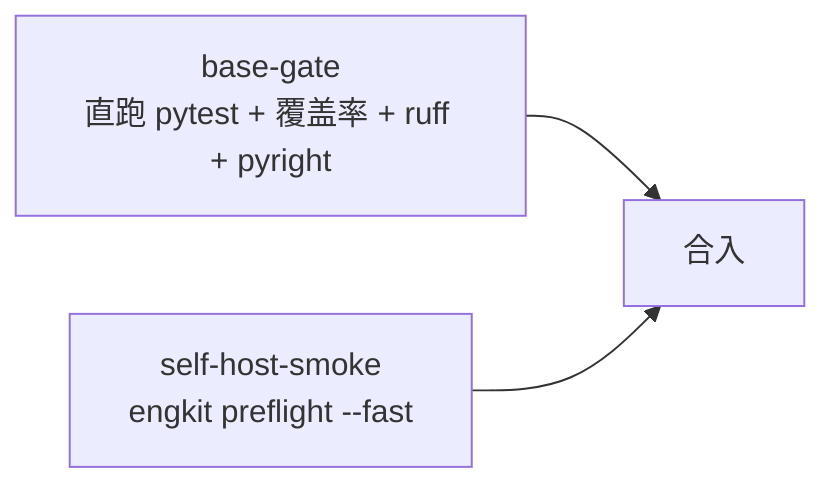

# 工程化工具包说明

> 定位、子命令、配置字段全表与门禁口径

[文档首页](../文档首页.md) › 概述　|　[接入说明 →](../资料/工具/接入说明/01_接入步骤.md)

## 1. 为什么抽成独立仓 <a id="why"></a>

护栏与开发脚本原先只在单个仓库内、且写死该仓的目录结构：文档校验只扫自己的文档根、预检的工程清单按本仓布局硬编码、用例登记只有文档模板没有脚本。各仓若各自复制一份，护栏会变成多份实现、口径必然分叉。

因此抽成**独立仓库与可安装包**：各仓以 git 源依赖或路径探测引用同一份实现，新增仓库只加配置、不改代码。

## 2. 四个设计约束 <a id="constraints"></a>

| # | 约束 | 落地方式 |
| --- | --- | --- |
| 1 | **包内无仓名字面** | 路径、工程分组、包名、步骤命令、规则数据一律来自仓配置；用例里由 `test_guards.py` 扫源码断言 |
| 2 | **单一来源** | 选测 / 并行档位 / 覆盖率门禁 / 重命令拦截各只有一份实现；各仓入口只做转发 |
| 3 | **核心零三方依赖** | 只依赖标准库（`tomllib` 解析配置）；增强能力缺装时显式降级。**唯一运行期依赖是 `pytest-xdist`**（并行档位 `-n` 的提供者，随本包安装，各接入仓无需自行声明；缺失时并行档位显式降级为串行） |
| 4 | **配置非法即失败** | 缺段 / 类型错 / 未知键一律报错退出码 2，不靠缺省值掩盖 |

## 3. 子命令 <a id="commands"></a>

| 子命令 | 作用 | 关键参数 | 退出码 |
| --- | --- | --- | --- |
| `links` | 文档相对链接与锚点校验 | `--root` `--config` `--quiet` | 0 通过 / 1 有问题 / 2 文档根缺失 |
| `docs-scope` | 进度类字段落点护栏 | `--self-test` | 0 零违规 / 1 有违规 / 2 文档根缺失 |
| `selection` | 变更 → 测试文件 / 覆盖率模块 / 前端包 | `--scope` `--changed-from` `--changed-file(-list)` `--format` `--force-full` | 0 正常 / 1 推导异常 |
| `run-selected` | 选测 → 跑 pytest → 覆盖率门禁 → 扩圈 → 退化 | `--changed-from` `--jobs` `--cov-fail-under` `--max-rounds` `--timeout` | pytest 码 / 1 异常 / 124 超时 |
| `coverage` | 合并并行采集数据并判定 | `--data-file` `--out` `--module` `--fail-under` `--clean` | 0 达标 / 1 未达标 / 2 环境错误 |
| `preflight` | 档位 + 预算 + 步骤调度 + 自测按需 | `--fast` / `--full` / `--no-scope` / `--no-cov` / `--jobs` / `--budget-seconds` / `--step-seconds` / `--self-test` | 0 全通过 / 1 有失败或被拦截 / 2 配置非法 |
| `run-once` | 重命令缓存回放 | `--force` `--show` `--window-seconds` `--cache-dir` | 透传 / 2 选项错 |
| `guard` | 重命令拦截与 `.pth` 钩子管理 | `check` / `install-hook` / `check-hook` / `remove-hook` | 0 放行 / 1 拦截或钩子缺失 / 2 参数错 |
| `kiwi` | 用例批量登记与回读 | `register --cases`（`--dry-run`）/ `list --limit` / `ping` | 0 成功 / 1 远端失败 / 2 凭据或清单问题 |
| `base <名>` | 基座校验器组（规则数据来自 `[rules.<名>]`） | `--self-test`（部分器）/ `--json` / `--report` / `--update-baseline` / `--changed` / `--task` / `--stage` / `--all` / `--strict` | 0 通过 / 1 有问题 / 2 规则未登记或登记源缺失 |

## 4. 配置字段全表（`engkit.toml`） <a id="config"></a>

### 4.1 通用段 <a id="config-common"></a>

| 段 / 键 | 说明 | 缺省 |
| --- | --- | --- |
| `[repo].name` | 输出文案用的仓名（不参与探测） | 仓目录名 |
| `[docs].root` | 文档根（相对仓根） | 必填 |
| `[docs].skip` | 不参与校验的路径前缀（如本地凭据目录） | 空 |
| `[docs.scope].allow_marker` | 行级豁免标记 | `docs-scope:allow` |
| `[docs.scope].whitelist_dirs` / `whitelist_files` | 文档根下白名单 | 空 |
| `[docs.scope].plan_dir_pattern` | 阶段计划目录正则 | 空 |
| `[docs.scope].extra_rules` | 追加规则（`pattern` + `label`） | 空 |

### 4.2 选测段 <a id="config-selection"></a>

| 段 / 键 | 说明 | 缺省 |
| --- | --- | --- |
| `[backend].root` | 后端根 | 必填（无后端可整段省略） |
| `[backend].groups` | 工程分组目录（`<root>/<group>/<工程>/{src,tests}`） | `["libs","services"]` |
| `[backend].test_prefix` | 测试文件名前缀 | `test_` |
| `[backend].projects` | 全量档工程范围（供「新增工程必登记」对账） | 空 |
| `[backend].coverage_packages` | 全量档覆盖率采集范围 | 空 |
| `[frontend].root` / `groups` / `workspace_protocol` | 前端 pnpm 工程发现 | 无前端可整段省略 |
| `[selection].base_threshold` / `base_ratio` | 基础模块退化阈值 | `100` / `0.6` |
| `[rules.backend.global]` | 全局变更（`exact` / `prefixes` / `config_prefix`+`config_suffix`） | 空 |
| `[[rules.backend.extra_tests]]` | 特殊路径 → 必跑测试（`test_dir_suffix` / `test_files` / `mapping`+`fallback_dir`，`coverage` 控制是否计入覆盖率） | 空 |
| `[rules.frontend.global]` | 前端根级变更 | 空 |

### 4.3 预检段 <a id="config-preflight"></a>

| 段 / 键 | 说明 | 缺省 |
| --- | --- | --- |
| `[pytest].cmd` / `cwd` / `max_rounds` | 执行器前缀、工作目录、扩圈轮次上限 | `python -m pytest` / `.` / `2` |
| `[coverage]` | 采集环境变量名、门禁阈值、采集插件、`PYTHONPATH`、数据文件、门禁解释器 | 见 `config.py` |
| `[preflight].cwd` / `since` | 缺省工作目录、变更基准 | `.` / `origin/main` |
| `[preflight.budget]` | `scoped` / `full` 两档（单步秒数, 总体秒数） | `300/420`、`900/1800` |
| `[[preflight.steps]]` | 步骤：`label` / `type` / `cmd` / `cwd` / `preset` / `optional` | — |
| `[[preflight.self_tests]]` | 自测：`label` / `cmd` / `deps`（触发前缀） | — |
| `[runonce]` | 缓存目录、回放窗口 | `.cache/run-once` / `1800` |
| `[guard]` | 一律拦截的脚本名、仓库级目录、目录判重阈值 | 空 / 空 / `20` |
| `[kiwi]` | 凭据文件、主机与账号键名、容器名、`manage.py` 路径 | 见 `config.py` |
| `[toolchain].baseline` | ruff 规则基线路径（相对仓根） | `toolchain/ruff-base.toml` |
| `[toolchain].ruff_configs` | 需校验「只 extend、不复制规则段」的仓配置路径（相对仓根；平级仓写 `../`，不存在即跳过） | 空 |

步骤 `type` 四种：`command`（普通命令）、`scoped_tests`（定向测试段）、`full_tests`（全量 + 覆盖率）、`project_tests`（逐工程范围）。`preset` 取 `always` / `scoped` / `fast` / `full`。

### 4.4 pytest 入口插件（覆盖率采集 + 重命令拦截） <a id="config-plugin"></a>

各仓 `addopts` 加 `-p engkit.coverage_plugin`、并把 `[coverage].plugin` 写成同一个值，即接入**唯一一份**采集与拦截实现：

| 能力 | 行为 |
| --- | --- |
| 覆盖率采集 | 插件模块导入即启动（**早于任何被测模块导入**，「导入期执行的行」也算覆盖）；数据文件与采集范围取自 `[coverage].data_env` / `source_env` 指向的环境变量（由 `engkit preflight` / `engkit run-selected` 注入）；按进程号落盘，`engkit coverage` 合并判定 |
| 重命令拦截 | 转调 `engkit.guard`：本地非 CI 跑全量 `pytest` / 无参数扫 `ruff`、`pyright` / 裸跑预检即 `UsageError`、用例零执行 |
| 未启用时 | 未注入采集环境变量或定位不到 `engkit.toml` 时静默不采，不影响正常跑测试 |

> 仓内若另需注册自有夹具（如测试公共基座），保留一个**只做转发**的仓内插件即可：顶层 `import engkit.coverage_plugin`（保证采集先启动）后转调其钩子，再注册自有夹具；**不得**在仓内另写采集或拦截逻辑。

### 4.5 基座校验器规则段（`[rules.<名>]`） <a id="config-base"></a>

**规则与判定分离**：判定在包内（`src/engkit/base/`），规则数据全部来自仓配置；**缺段即该校验器未启用**，显式调用退 2 并给出最小键指引（不靠缺省值掩盖）。

| 段 | 对应子命令 | 规则内容（键名见 `config.py`） |
| --- | --- | --- |
| `[rules.base]` | `base base` | 基座清单 / 基座目录 / 跨层前缀 / 措辞残留 / 设计登记（`design`）/ 命名面（`naming`）/ 运行期登记值（`runtime`） |
| `[rules.backend_base]` | `base backend-base` | 基类清单 / 实现契约 / 源码面 / 错误码模块 / 迁移版本目录 / 直继承基线 / 体系根标记与值对象、框架对象根名 / 数据源段 / 缺省链 / 域布局 |
| `[rules.bare_collections]` | `base bare-collections` | 扫描面 / 白名单 / 判违规形态（`banned`）/ 未登记形态 / 元组与协议形态 / 实现文件 / 豁免标记 / 基线（`baseline` + `baseline_version`）/ 原因文案（`reasons`） |
| `[rules.system_fields]` | `base system-fields` | 表文件目录 / 字段行名 + `catalog` / `datasource` 两个登记源（路径、常量名、枚举名、键字段） |
| `[rules.prototype]` | `base prototype-review` | 记录与上下文路径正则 / 原型引用正则 / 界面源码正则 / 对照节标题 / 表头关键词 / 截图正则 / 未完成词 / 不适用词与理由长度 / 变更基准 |
| `[rules.env_example]` | `base env-example` | 模板清单（`[[rules.env_example.templates]]`：`path` + `required_keys`）/ 已移除键 / 私钥标记 / 占位标记 |
| `[rules.docs_status]` | `base docs-status` | 阶段目录 / 缺省阶段 / 状态取值 / 编号正则 / 文件匹配式 / 附属目录 + 记录目录 / 表列数 |
| `[rules.service_boundaries]` | `base service-boundaries`? | 服务维与域级判定的登记源（表归属模块、域布局、例外白名单、域基线） |
| `[rules.metrics]` | `base boundary-metrics`? | 越界计数键 / 指标行正则 / 静态校验子命令 |

> `?` 标记的两段随 `13_06` 第二批落地（判定与 CLI 注册同批提交），字段形态已按「登记源留仓内、engkit 只做判定」定稿。

## 5. 工具链基线（ruff 规则与版本） <a id="toolchain"></a>

> **状态：已落地**（bms 任务 `13_07`，需求 `13-7`）。基线文件为仓根 `toolchain/ruff-base.toml`，版本组为 `[project.optional-dependencies].devtools`，护栏用例为 `tests/test_toolchain.py`（Kiwi 2360）。

**ruff 规则与 ruff / pyright 版本也走单一来源**：规则基线文件在本仓，版本经可选依赖组下发。各仓不再复制规则段、不再各自声明工具版本。

### 5.1 基线文件与引用写法 <a id="toolchain-baseline"></a>

基线落本仓 **仓根 `toolchain/ruff-base.toml`**（工具链资产不是包代码，故不打包内）：

```toml
line-length = 120

[lint]
select = ["E", "F", "W", "I", "B", "UP", "SIM", "RUF"]
ignore = ["RUF001", "RUF002", "RUF003"]
```

各仓 `pyproject.toml` 只写 `extend` + **本仓专属项**：

```toml
[tool.ruff]
extend = "../../engkit/toolchain/ruff-base.toml"   # 相对本配置文件所在目录
target-version = "py314"                           # 本仓属性，不进基线

[tool.ruff.lint.isort]
known-first-party = ["<本仓包名>"]                  # 本仓属性，不进基线
```

**不进基线**的项：`target-version`（本仓 Python 版本）、`known-first-party` / `src`（本仓结构）、`extend-exclude` / `per-file-ignores`（本仓路径）。

### 5.2 版本下发 <a id="toolchain-version"></a>

```toml
[project.optional-dependencies]
devtools = ["ruff==0.17.2", "pyright==1.1.414"]
```

接入仓以 `engkit[devtools]` 的 git 源依赖取得（与 `engkit` 本身同一个 `rev`），**升级只改 engkit 的 rev**。

**版本号用 `==` 严格同版**：早期设计用 `>=` 下限 + 各仓锁文件固化，实测各仓按各自解析时机落到**不同补丁版**（bms / mdm 落 0.17.2、engkit 仍 0.17.1），诊断与格式化口径仍有分叉空间；`==` 使「三仓同版」成为结构性事实，代价是任何补丁升级都要改本处并发一次 rev——正是「升级只改一处」的目标形态（`tests/test_toolchain.py` 断言 `==`）。

### 5.3 两条约束（实测得出） <a id="toolchain-rules"></a>

| # | 约束 | 原因 |
| --- | --- | --- |
| 1 | 基线路径**只能是相对路径**，不能用环境变量 | ruff 的 `extend` 不展开 `${VAR}`（实测按字面路径读取并失败） |
| 2 | 不得用 `ruff --config <基线>` 代替 `extend` | `--config` 会**整体替代**仓内配置，仓专属段（`known-first-party` 等）全部失效；且 ruff 不允许多个 `--config` |

**缺克隆即失败**：基线缺失时 ruff 直接退出码 2（信息含「哪个配置 extends 哪个文件」），不静默回落——engkit 为工作区必选仓，各仓**不得**在仓内留基线副本。

**机器护栏**：`tests/test_toolchain.py` 断言三件事——基线只含共用项（`line-length` / `[lint].select` / `[lint].ignore`，且不含 `target-version` / `known-first-party`）、各仓 `[tool.ruff]` 只 `extend` 不复制规则段（`extend` 目标必须可解析）、`devtools` 组声明 ruff / pyright 版本下限且仓内 dev 组不重复声明。受检仓配置由本仓 `engkit.toml` 的 `[toolchain].ruff_configs` 登记，**路径不存在即跳过**（CI 只 clone 本仓时不误判）。

**排障**：报 `Failed to load extended configuration` 即说明 engkit 克隆缺失或路径写错，按《接入说明》§1 克隆并核对相对层级。

## 6. 门禁与自举 <a id="gate"></a>



- **基础门禁直跑**：不经过 engkit 自身，引擎故障时仍能给出真实结论；
- **自举烟雾**：用本仓 `engkit.toml` 跑一遍 `preflight --fast`，验证「换仓仍可用」；失败即阻断，不设软门禁；
- **触发口径（2026-10-26 起，三仓同口径）**：**推送不触发流水线**——engkit 仓 `workflow.rules` 只放行 `web` / `api`（手工触发，手工触发即全量），推送因此**无需** `-o ci.skip`；日常验证以本地 `engkit preflight` 为准，CI 承担按需复核。详见平台《开发部署规划》「开发工作流与 CI」节；
- 覆盖率门槛口径见《AI开发规范》「覆盖率要求」节，本包不复述数字。

## 7. 已知边界 <a id="limits"></a>

| 项 | 说明 |
| --- | --- |
| `ruff` 无法被 `.pth` 钩子拦截 | 原生二进制不经 Python 解释器；其大范围调用靠规范与预检兜底 |
| Kiwi 走 SSH + Django shell | JSON-RPC 会话鉴权未打通（`Auth.login` 可取会话键，业务方法鉴权失败）；登记本就是本地动作 |
| 动态导入 / 字符串化导入 | AST 图抓不到，由覆盖率扩圈与显式退化兜底 |
| 类型门禁范围 | 仅包源码 `src/`；用例由 pytest + ruff 把关 |
| 工具链基线只覆盖 ruff 规则 | pyright 配置各仓结构差异大（`include` / `extraPaths` / `pythonVersion` 各异），本仓只下发其**版本**；前端（pnpm / eslint / vitest）不在本包能力边界，需另发 JS 共享包 |
| 基线读的是**文件路径**而非包内路径 | ruff 的 `extend` 只能读文件，读不了安装包内的资源；故各仓必须有 engkit 克隆（`[coverage]` 采集插件等走包，两者路径不同） |
