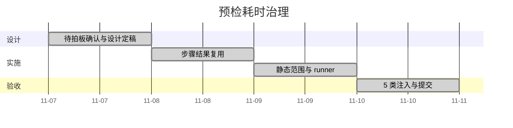

# 预检耗时治理 · 计划

> 进度唯一落点：状态 / 完成日期 / 实际投入 / 排期窗口只在本文件维护

[文档首页](../../../文档首页.md) › 项目 › 工程化 › 预检耗时治理　|　[← 需求](需求.md)　[详细设计](设计/详细设计.md)

## 1. 计划说明 

- **排期对象**：本专项 4 条需求（14-1 ~ 14-4）对应的 4 个任务，域号 `14`（engkit 自身工程化域，与 bms `13_*` 工程化任务区分）。
- **口径**：一个任务最多两次提交（`feat(engkit)` + `docs(engkit)`）；推送只在模块收尾时做一次，本专项按要求**只 commit 不 push**。
- **负责人**：AI 实施 + 用户逐项拍板（12 项已确认，见《详细设计》§9）。
- **里程碑锚点**：基准采样 → 三件事落地 → 5 类注入全绿 → 提交。

## 2. 已完成任务（2026-11-07 ~ 2026-11-07） 

| 编号 | 任务 | 工时（重估） | 完成日期 | 任务文件 | 偏差与遗留 |
| --- | --- | --- | --- | --- | --- |
| 14_00 | 待拍板项确认与设计定稿 | 2h | 2026-11-07 | [需求](需求.md) | 偏差：输入集推断原拟写目录字面，与红线 1 冲突，改为读配置值；遗留：无 |
| 14_01 | 步骤结果复用（缓存键 / 输入指纹 / 记录） | 6h | 2026-11-07 | [详细设计](设计/详细设计.md) | 偏差：新增「自身产物排除」（自污染）与「工作树未提交内容计入指纹」两项设计回写；定向用例段按设计不接入；遗留：无 |
| 14_02 | 推送环静态范围（pyright 闭包 + 退化） | 4h | 2026-11-07 | [详细设计](设计/详细设计.md) | 无 |
| 14_03 | 护栏单进程 runner（`engkit checks`） | 5h | 2026-11-07 | [详细设计](设计/详细设计.md) | 偏差：非「python 脚本」形态改为回退子进程（原设计判失败会打断既有配置）；遗留：单条超时移交 `process` 模式 |
| 14_04 | 5 类注入验收 + 提交 | 4h | 2026-11-07 | [测试记录](记录/测试记录.md) | 偏差：首次推送前未验全仓覆盖率，推送后补验 99% → 补 4 份用例达 100% 并补一次提交；遗留：耗时绝对值待下一次真实推送采样后回填（归口「模块收尾推送」） |

## 3. 剩余任务排期（自 2026-11-07） 

| 编号 | 任务 | 状态 | 工时 | 依赖 | 排期窗口 | 备注 | 偏差与遗留 |
| --- | --- | --- | --- | --- | --- | --- | --- |
| — | （无剩余任务） | — | — | — | — | 二期「步骤内产物缓存」与「覆盖率判定单元」见《详细设计》§8 开放项 | — |

## 4. 排期甘特图 

## 5. 验收门禁 

| 门禁 | 判据 | 本地（editable 路径依赖，即时生效） | CI（克隆 engkit，跟随 main 头） |
| --- | --- | --- | --- |
| 复用正确性 | 同输入命中、输入变即重跑 | 用例 + 手工双跑 | 已生效（engkit 于 2026-11-07 推送 main） |
| 负向拦截 | 5 类注入全部被拦 | `tests/test_steps_reuse.py` 全绿 | 已生效 |
| 判据不降级 | 覆盖率 / 静态 / 用例结论与改造前一致 | 全仓覆盖率 100%、793 用例全绿 | 已生效（`--cov-fail-under=100`） |
| 耗时目标 | 推送环下降 ≥50%、提交环下降 ≥40% | **基准待采样**（见 14_04 备注） | 同一口径，基准采样后回填 |
| 生效状态 | 本地 vs CI 版本一致 | 已生效（本次提交） | 已生效（`988232b..216bfc5` 已推送） |

> 耗时目标为相对值；绝对值等基准采样完成后回填本表，未回填前不宣称达标。

## 6. 风险与对策 

| 风险 | 影响 | 对策 |
| --- | --- | --- |
| 假命中（输入指纹没覆盖实际读取范围） | 缺陷进主干 | 未声明输入集一律退化整树；5 类注入第 1 类专门验「代码变但键不变」 |
| 单进程 runner 全局状态污染 | 检查互相影响、结果不可信 | 前后快照 `argv` / `sys.path` / 环境变量；脚本契约「不得设置全局状态」；保留 `process` 回退 |
| 闭包漏判（改基类只检直接依赖者） | 类型错误延后到 CI 暴露 | 超阈值 / 全局输入即退化全仓；CI 全量兜底；本项只作用于推送环 |
| 缓存误共享（跨仓 / 跨 clone） | 判据串味 | 缓存键含仓配置哈希，落点仓内 `.cache`；注入第 5 类专门验证 |
| 基准采样推迟 | 目标无法定量 | 目标先定相对值；绝对值留空位，采样后回填，不先填数 |
| engkit 未推送期间 CI 与本地判据不一致 | 排障困惑 | 计划 / 实施记录双处登记前置依赖；验收分两行 |
