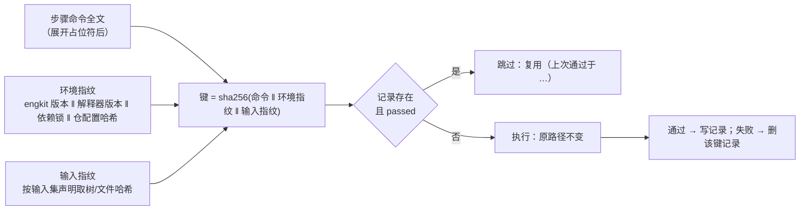
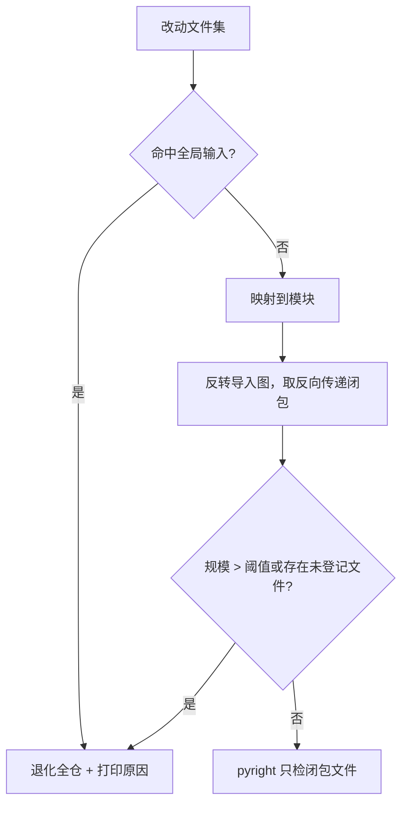

# 预检耗时治理 · 详细设计

> 核心文档：实施与验收一律以此为准；与代码不一致时先改本设计

[文档首页](../../../../文档首页.md) › 项目 › 工程化 › 预检耗时治理　|　[← 需求](../需求.md)　[计划 →](../计划.md)

## 1. 设计目标与总原则 <a id="goal"></a>

**一句话**：把「同一输入下的重复计算」去掉，不改任何判据。

总原则（对应《工具包开发约定》三条红线与本域红线）：

1. **跳过只允许发生在「同输入且该输入下已通过」**——输入变、版本变、键缺失、记录损坏，一律真跑。
2. **fail-open 到执行**：任何异常路径的默认动作是「跑」，不是「跳过」。异常只允许打印原因，不允许改变判定结果。
3. **包内无仓名字面**：所有目录一律取 `[docs].root` / `[frontend].root` / `[backend].root` 配置值。
4. **单一来源**：反向依赖闭包只在 `selection.py` 实现；缓存判定只在新增的 `steps_reuse.py` 实现；各仓入口零逻辑。

## 2. 交付物清单 <a id="deliverables"></a>

```text
engkit/
├── src/engkit/
│   ├── steps_reuse.py        # 新增：缓存键、输入集指纹、记录读写（唯一实现）
│   ├── checks.py             # 新增：单进程护栏 runner（唯一实现）
│   ├── preflight.py          # 改：command 步骤接入复用；自测段改走 checks；pyright 闭包
│   ├── selection.py          # 改：新增反向依赖闭包（reverse_dependents）
│   ├── config.py             # 改：Step 增加 inputs / scope；PreflightConfig 增加 reuse / checks_runner
│   └── cli.py                # 改：新增 checks 子命令
├── engkit.toml               # 改：[docs.scope].plan_dir_pattern（项目树计划目录）
├── tests/
│   ├── test_steps_reuse.py   # 新增：5 类负向注入 + 命中/失效正路径
│   ├── test_checks.py        # 新增：单进程 runner 隔离、异常、汇总
│   └── test_static_scope.py  # 新增：闭包推导与退化
└── engkit文档/项目/工程化/预检耗时治理/   # 本专项（需求 / 设计 / 计划 / 记录）
```

## 3. 步骤结果复用 <a id="reuse"></a>

### 3.1 缓存键 <a id="reuse-key"></a>



**键的三个组成**（缺一不可，对应红线）：

| 组成 | 取值 | 变即失效的原因 |
| --- | --- | --- |
| 步骤命令全文 | `expand()` 展开 `{python}` / `{root}` / `{config}` 后的完整 argv 拼接 | 命令或参数变了，判的东西就变了 |
| 环境指纹 | engkit 包版本 + `sys.version` + `pyproject.toml` / `uv.lock`（存在时）内容哈希 + `engkit.toml` 内容哈希 | 工具链或门禁配置变了，同一份代码的结论可能不同 |
| 输入指纹 | 输入集内各路径前缀的 git 树 / blob 哈希（见 3.2） | 被检内容变了 |

### 3.2 输入集与指纹 <a id="reuse-inputs"></a>

**声明优先**：步骤可在 `engkit.toml` 写 `inputs = ["<仓根相对前缀>", …]`；只支持**目录前缀与单文件**（不支持 glob，保证 O(1) 取哈希）。

**推断兜底**（未声明时，按命令形态，只用配置值）：

| 命令形态 | 推断输入集 | 依据 |
| --- | --- | --- |
| 含 `--files-from` 或 argv 中出现 `{files}` | 当次改动文件集 | 增量步骤只读改动文件 |
| argv 中首个路径参数落在 `[docs].root` 下 | 该文件 / 目录前缀 | 文档类步骤只读文档 |
| argv 中首个路径参数落在 `[frontend].root` 下 | `[frontend].root` | 前端类型检查读整个工作区工程与依赖闭包 |
| argv 中首个路径参数落在 `[backend].root` 下 | `[backend].root` | 后端静态检查读整个后端 |
| 其余（含 `.` / 仓根 / 无法识别） | 整棵树 | 最保守：退化为 tree hash |

**取哈希的实现**：`git write-tree` 取得「索引内容」的根树（提交环跑在提交钩子内，索引即待提交内容；推送环工作树干净，等价 HEAD），再对每个前缀 `git rev-parse <tree>:<prefix>` 取子树 / blob 哈希。取不到（前缀不存在 / git 不可用 / 索引不可写）→ **输入指纹缺失 → 该步不命中**（真跑）。

> 为什么不用 `HEAD` 直接取：提交环触发时 `HEAD` 还是上一次提交，用 `HEAD` 会把「新内容」误判成「旧内容」，是典型的假命中。

### 3.3 记录存储 <a id="reuse-store"></a>

落点：`<仓根>/.cache/preflight/steps.json`（与 `audit.jsonl` 同目录，`.cache` 已忽略）。

```json
{
  "schema": 1,
  "entries": {
    "<键十六进制>": {
      "command": "pnpm -r typecheck",
      "env": "<环境指纹>",
      "inputs": "<输入指纹>",
      "passed_at": "2026-11-07T03:12:44+00:00",
      "duration": 48.8,
      "label": "前端：类型检查"
    }
  }
}
```

- **原子写**：写临时文件后 `os.replace`；写失败只打印原因，不影响本次判定。
- **读失败**（不存在 / JSON 损坏 / `schema` 不符）：视为全部未命中，打印一次原因。
- **清理**：读入时丢弃 `passed_at` 超过 7 天的条目与 `schema` 不符的条目；写回时一并落盘。
- **容量**：条目数上限 200，超出按 `passed_at` 淘汰最旧（防止长期累积）。

### 3.4 接入点 <a id="reuse-hook"></a>

| 接入点 | 处理 | 说明 |
| --- | --- | --- |
| `execute()` 的 `command` 步骤 | 执行前查键 → 命中则打印并返回成功；未命中则执行，成功后写记录、失败则删除同键记录 | 覆盖 12 个脚本级步骤与静态步骤 |
| `run_self_tests()` 每条自测 | 同上；输入集按 `deps` 前缀声明 | 护栏检查同样受益 |
| `_run_scoped_step()`（定向用例 + 覆盖率） | **不接入** | 产出是覆盖率数据，跳过会让 `coverage_report.py` 读旧数据；实测仅 17.9s，不做 |
| `full_tests` / `project_tests` | **不接入** | 仅 CI 执行，无重复计算场景 |

**开关**：`[preflight].reuse = true`（缺省开）；关闭时全部步骤真跑，行为与改造前一致。

### 3.5 失败分支 <a id="reuse-fail"></a>

| 场景 | 动作 | 输出 |
| --- | --- | --- |
| 缓存文件不存在 | 真跑 | 不打印（首次正常） |
| JSON 损坏 / schema 不符 | 全部真跑 | `复用不可用（记录损坏：…）` |
| 写入失败（只读 / 无权限） | 真跑（本次结论不受影响） | `复用记录写入失败（原因）；本次仍按真跑结论判定` |
| 输入指纹取不到（git 异常 / 前缀缺失） | 该步真跑 | `复用未命中（输入指纹缺失：…）` |
| 上次结果为失败 | 真跑（失败记录即时删除，不留「失败可复用」） | — |
| 步骤声明了 `inputs` 但目录在仓内不存在 | 该步真跑 | `复用未命中（输入前缀不存在：…）` |

## 4. 推送环静态范围（pyright 闭包） <a id="scope"></a>

### 4.1 配置与语义 <a id="scope-config"></a>

步骤新增 `scope` 键：

```toml
{ label = "静态：pyright", cmd = ["{python}", "-m", "pyright", "."], scope = "changed-closure" }
```

- `scope = "full"`（缺省）：原样执行，判据不变。
- `scope = "changed-closure"`：把命令末尾的仓根路径参数替换为「改动文件 ∪ 反向依赖者」清单；**空改动或退化时回退 `full` 并打印原因**。

### 4.2 闭包推导 <a id="scope-closure"></a>



- 反向闭包在 `selection.py` 实现（`reverse_dependents`），复用现有模块发现与 `parse_imports`，不新增第二份解析实现。
- 全局输入判定复用 `[rules.backend.global]`（`exact` / `prefixes` / `config_prefix`+`config_suffix`）。
- 阈值取「闭包文件数 ≥ 全仓可检文件数 × 0.6」即退化（比例取 `[selection].base_ratio`，与选测退化口径同源）。
- 退化必须打印：`静态范围退化：全仓（原因：…）`。

### 4.3 提交环 <a id="scope-commit"></a>

提交环 pyright 步骤**不声明** `scope`，保持全仓 `pyright .`：实测 8.2s，收窄收益不抵漏判风险（改基类会让反向闭包覆盖几乎所有服务，实际很少命中收益）。本项只作用于推送环，故只在推送环的步骤表写法上体现；两环共用同一份 `[[preflight.steps]]` 时，以 `preset` 区分（推送环专属步骤声明 `scope`，提交环走 `--files-from` 增量路径）。

## 5. 护栏单进程 runner <a id="checks"></a>

### 5.1 命令与配置 <a id="checks-cli"></a>

```bash
engkit checks --config engkit.toml [--only <label>…] [--json]
```

- 读 `[[preflight.self_tests]]`，按声明序执行；`--only` 可按标签过滤（排障用）。
- 模式由 `[preflight].checks_runner` 决定：`single`（缺省，单进程） / `process`（逐条子进程，回退通路）。

### 5.2 执行模型 <a id="checks-model"></a>

| 环节 | 做法 |
| --- | --- |
| 入口解析 | `cmd` 形如 `["{python}", "<脚本>", *args]`；取脚本路径与参数，同进程 `runpy.run_path(script, run_name="__main__")` |
| 参数注入 | 执行前保存 `sys.argv`，替换为 `[脚本路径, *args]`；执行后恢复 |
| 状态隔离 | 保存 / 恢复 `sys.path`、`os.environ` 快照；新增 `sys.modules` 条目**保留**（清理会破坏 engkit 自身已导入模块），故约定「检查脚本不得设置影响后续的全局状态」 |
| 退出码 | 捕获 `SystemExit`（`code` 为 `None`/`0` 记通过，其余记失败）；未捕获异常记失败并打印类型与消息，继续下一条 |
| 输出 | 每条前置 `[checks] <label>`，末尾 `通过（0.3s）` / `失败（退出码 1；0.3s）`，与 `execute()` 口径一致 |
| 汇总 | 末尾一行 `[checks] 通过 N / 失败 M`；失败列出标签；退出码 0 / 1 |
| 预算 | 复用 `Budget`：单条超时与总体超时均按 `execute()` 同口径判定，超时记失败并中止剩余条目（与现有预算护栏语义一致） |

### 5.3 与预检的衔接 <a id="checks-preflight"></a>

- `run_self_tests()` 在 `single` 模式下改为**一次**调用 `checks.run_entries(cfg, entries, budget)`，不再逐条 `execute()`；`process` 模式保持原逐条 `execute()`。
- 逐条耗时与失败标签仍进 `failures` 列表，最终由 `finish("preflight", failures)` 汇总，**汇总格式不变**（避免破坏既有日志解析与审计）。
- 单条脚本若自身探测到「缺 X 则跳过」，行为不变（脚本内部逻辑）。

## 6. 配置变更（向后兼容） <a id="config"></a>

| 段 / 键 | 类型 | 缺省 | 说明 |
| --- | --- | --- | --- |
| `[[preflight.steps]].inputs` | `list[str]` | `[]`（走推断） | 输入集路径前缀 / 单文件（仓根相对） |
| `[[preflight.steps]].scope` | `str` | `"full"` | `full` / `changed-closure` |
| `[preflight].reuse` | `bool` | `true` | 步骤结果复用总开关 |
| `[preflight].checks_runner` | `str` | `"single"` | `single` / `process` |
| `[preflight].reuse_file` | `str` | `.cache/preflight/steps.json` | 记录落点 |
| `[preflight].reuse_ttl_days` | `int` | `7` | 条目过期天数 |

**兼容性**：全部为**可选新增键，缺省即启用新行为**；未改配置的仓在升级 engkit 后自动获得复用与单进程 runner。若需保持旧行为，显式写 `reuse = false` / `checks_runner = "process"`。这属于「对外行为变更」，按《工具包开发约定》§4 在《工程化工具包说明》登记。

## 7. 测试设计与验收映射 <a id="test"></a>

### 7.1 正路径 <a id="test-positive"></a>

| 用例 | 断言 |
| --- | --- |
| 同输入连续两次预检 | 第二次对应步骤输出「复用」，总耗时低于第一次，退出码一致 |
| 改动代码后再跑 | 同一步骤不命中（输入指纹变化） |
| 只改文档（`docs` 提交后推送） | 代码步骤命中、文档步骤重跑 |
| `reuse = false` | 全部真跑，无「复用」输出 |

### 7.2 负向 5 类注入（缺一不可） <a id="test-negative"></a>

| # | 注入方式 | 期望 |
| --- | --- | --- |
| 1 | 改写被检文件但**手工篡改记录**使其键保持不变（模拟假命中） | 输入指纹不匹配 → 重跑；注入的类型错误 / 断言失败必须报红 |
| 2 | 把 `steps.json` 写成非法 JSON；再改为只读文件 | 前者全部真跑且结论与无缓存一致；后者打印写入失败、本次判定不受影响 |
| 3 | 在 `engkit.toml` 增加一条 `type` 未知的步骤 | 配置解析即报错（fail-closed），零步骤执行 |
| 4 | 注入真实缺陷：类型错误 / 覆盖率缺口 / 文档死链 | 对应步骤报红，退出码非零（验证「跳过逻辑不吞缺陷」） |
| 5 | 两份不同 `engkit.toml`（环境指纹不同）共用同一 `steps.json` | 不互相命中（环境指纹进入键） |

### 7.3 覆盖率与门禁 <a id="test-coverage"></a>

- 新增模块 `steps_reuse.py` / `checks.py` 与改动模块 `preflight.py` / `selection.py` / `config.py` / `cli.py` 行 + 分支 100%；
- 分支覆盖重点：命中 / 未命中 / 记录损坏 / 写入失败 / 指纹缺失 / 退化 / 超时中止 / 单条异常继续；
- 提交前：`uv run pytest --cov=src/engkit --cov-branch --cov-fail-under=100`；
- 静态：`uv run ruff check .`、`uv run ruff format --check .`、`uv run pyright`。

### 7.4 验收映射 <a id="test-accept"></a>

| 需求 | 验收证据 | 门禁点 |
| --- | --- | --- |
| 14-1 复用 | 正路径 4 条 + 负向 1/2/5 | `tests/test_steps_reuse.py` |
| 14-2 静态范围 | 闭包正路径、退化（全局输入 / 超阈值 / 未登记文件） | `tests/test_static_scope.py` |
| 14-3 进程合并 | 单进程 vs 逐条总耗时、单条异常继续、汇总格式不变 | `tests/test_checks.py` |
| 14-4 度量与负向 | 基准留档 + 5 类注入全拦 + 两行验收 | 实施记录 / 测试记录 |

## 8. 边界与开放项 <a id="limits"></a>

**边界**：

1. 输入集只支持目录前缀与单文件，不支持 glob / 正则——为换取 O(1) 取哈希；确有 glob 需求时在仓配置写更窄的前缀。
2. 单进程 runner 不清理 `sys.modules`，脚本间存在理论上的全局状态污染；以「检查脚本不得设置全局状态」为契约，异常情况回退 `process` 模式。
3. 复用不覆盖 `scoped_tests`（覆盖率数据时效）与 CI 专属段。
4. 前端类型检查仍在每次命中失败时全量执行（41% 的大头留待二期产物缓存）。

**开放项（登记去向）**：

| 项 | 状态 | 归口 |
| --- | --- | --- |
| 步骤内产物缓存（`tsc incremental` / pyright 结果文件） | 二期，接口已在 `steps_reuse` 预留 | 本专项二期 |
| 覆盖率判定单元改函数级 / 历史基线 | 不在本域，需单独立项并配责任人台账 | 计划表「后续待办」 |
| 覆盖率采集数据随 `scoped_tests` 复用 | 不做，理由见需求 14-1 第 7 条 | 本设计 |
| engkit 推送后 CI 才生效 | 前置依赖，验收分两行 | 计划表验收段 |

## 9. 对齐记录 <a id="align"></a>

| 日期 | 事项 | 结论 |
| --- | --- | --- |
| 2026-11-07 | 命中判定键 | 采用「步骤输入集指纹 + 缺省回退 tree hash」；严格 tree hash 会让 `docs` 提交后推送环零命中，收益归零 |
| 2026-11-07 | 输入集来源 | 内置推断 + 仓可覆盖；但推断表**不得写目录字面**（红线 1），一律读 `[docs]/[frontend]/[backend].root` |
| 2026-11-07 | 护栏合并形态 | 单进程 `runpy`，**不要求脚本改造 `main` 签名**（原选项描述中的「12 个脚本补 `main(argv)`」据此修正，风险更低） |
| 2026-11-07 | pyright 范围 | 只治推送环；提交环保持全仓（8.2s，收益不抵漏判风险） |
| 2026-11-07 | 覆盖率判定单元 | 本专项不改，登记为后续专项 |
| 2026-11-07 | 基准取法 | 真推送自然采样；不用临时 clone（冷启动偏高）、不用历史日志重建（缺分步数据） |
| 2026-11-07 | 缓存落点 | 仓内 `.cache/preflight/`；全局缓存有跨环境假命中风险 |
| 2026-11-07 | 定向用例段 | 不接入复用（覆盖率数据时效），实测 17.9s 不做 |
| 2026-11-07 | **自身产物排除** | 实施中发现自污染：记录文件写在仓内会被计入输入指纹，写一次指纹变一次、复用永不命中。新增 `_is_artifact` 排除 `.git/`、`reuse_file`、`audit_file`、`coverage.data_file`（含按 pid 派生的文件），不依赖各仓 `.gitignore` |
| 2026-11-07 | **输入指纹口径扩展** | 仅取 `git write-tree` 会漏掉「改了但没 add」的文件（假命中）。改为「索引树对象 + 工作树未提交内容（按输入集过滤）」，宁可多失效 |
| 2026-11-07 | **单进程 runner 的形态回退** | 原设计「非 python 脚本形态判失败」会打断既有配置（`echo` / `-c` 形态）。改为**回退子进程执行**；同时明确同进程**不设单条超时**（超时保护由 `process` 模式提供） |

> 依《文档生成规范》编写；进度见[计划](../计划.md)，实施留痕见[记录](../记录/实施记录.md)
